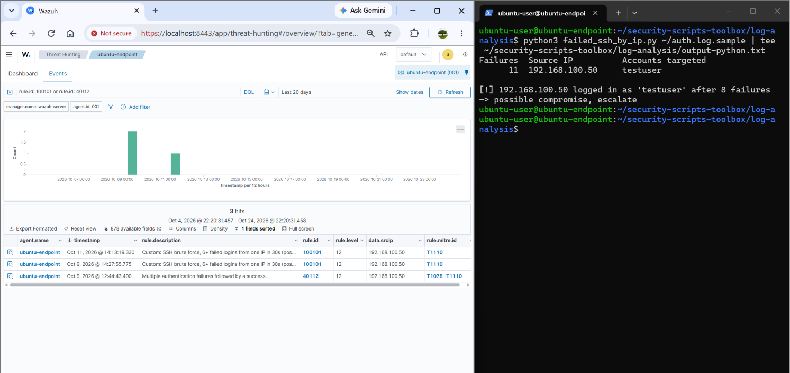
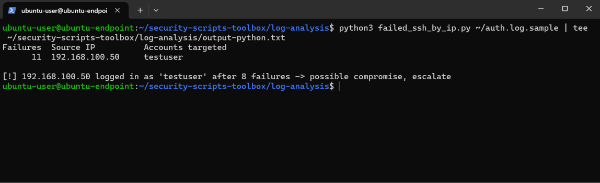
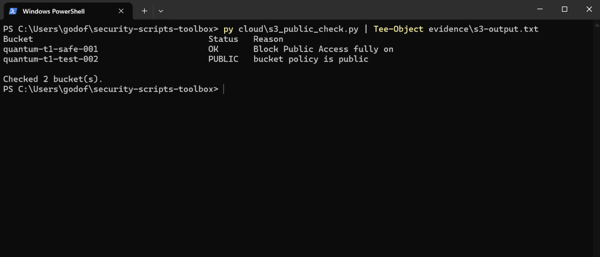
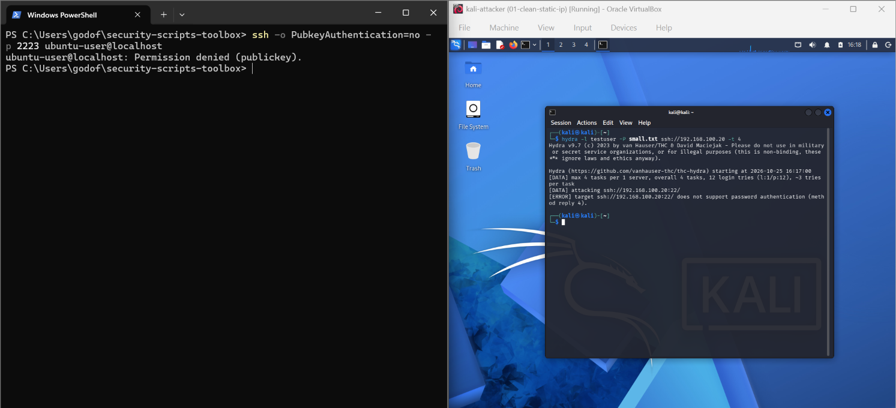

# Security Scripts Toolbox


Small, read-only Python and shell tools for SOC work: parse SSH authentication logs, flag public S3 buckets, and a verified SSH hardening baseline. Built in a lab environment, using real data from my own attack test in [soc-home-lab](https://github.com/cdbyte-code/soc-home-lab).


## Evidence: my script agrees with the SIEM





*Wazuh flagged `192.168.100.50` for SSH brute force (MITRE T1110). My script independently counts 11 failed logins from that IP and reports a success after 8 of them, the same pattern as Wazuh rule 40112.*


## What I built


| Tool | What it does |

| --- | --- |

| `log-analysis/failed_ssh_by_ip.sh` | Bash/awk: counts failed SSH logins by source IP |

| `log-analysis/failed_ssh_by_ip.py` | Python: counts failures per IP, lists targeted accounts, flags a success after repeated failures |

| `cloud/s3_public_check.py` | boto3, read-only: reports each S3 bucket as OK, WARN or PUBLIC |

| `hardening/SSH_HARDENING.md` | SSH hardening (keys only, no root login) with before/after proof |


## How to run


```bash

# Bash (Linux, or Git Bash on Windows)

./log-analysis/failed_ssh_by_ip.sh log-analysis/sample/auth.log.sample


# Python

py log-analysis/failed_ssh_by_ip.py log-analysis/sample/auth.log.sample


# S3 checker (needs an AWS profile with read-only S3 permissions)

py -m pip install -r requirements.txt

$env:AWS_PROFILE = "toolbox"

py cloud/s3_public_check.py

```


`cloud/iam-policy-readonly.json` holds the least-privilege policy the S3 script needs (list buckets and read their access settings only).


Sample data is generated by my own Hydra test in an isolated lab.


## Results


**Logs.** Bash and Python agree on 11 failed logins from one IP. The raw `grep "Failed password"` count was higher (19) because `sudo` also logged my own commands containing that phrase, so the scripts match on the structure `from <ip>` instead of the text alone. Python reports 8 failures before the success, because Hydra ran 4 parallel connections and 3 more failures were logged after the successful login.





**S3.** One bucket with Block Public Access on (OK) and one test bucket with a public policy (PUBLIC), both empty, deleted after testing.





**SSH hardening.** Before: Hydra guessed the password in 12 attempts. After: password login is refused and Hydra cannot even attempt it. Details in [hardening/SSH_HARDENING.md](hardening/SSH_HARDENING.md).





## What I'd improve


- The S3 script does not check account-level Block Public Access or object-level ACLs.

- Output is plain text; JSON output would let other tools consume it.

- The log scripts assume the standard `auth.log` format; other distros need their patterns adjusted.

- Add fail2ban and an SSH allow-list (ufw) to the hardening baseline.


## Skills shown


Python, Bash, awk, regular expressions, boto3, AWS S3, IAM least privilege, SSH hardening, log analysis, MITRE ATT&CK (T1110), Git.

