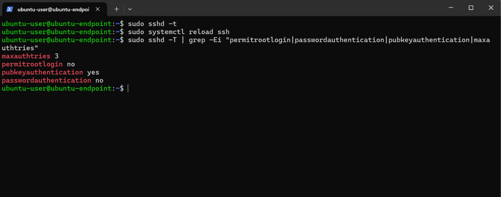
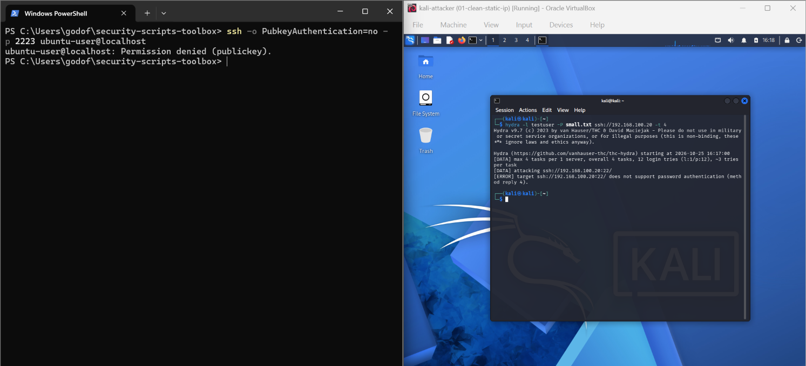

# SSH Hardening

Built in a lab environment: an Ubuntu VM on an isolated VirtualBox network.

## 1. Why

My Hydra test (MITRE T1110, Brute Force) guessed the password `Password1` for `testuser` in about 12 attempts, and Wazuh rule 40112 flagged the success after the failures. Passwords can be guessed. Keys cannot, in practice, so I removed password logins.

## 2. Settings applied

File: `/etc/ssh/sshd_config.d/00-hardening.conf` (copy in this folder).

| Setting | Value | Why |

| --- | --- | --- |

| PermitRootLogin | no | Attackers always try `root` first |

| PasswordAuthentication | no | Removes password guessing entirely |

| PubkeyAuthentication | yes | Allows key-based login |

| MaxAuthTries | 3 | Fewer guesses per connection |

The file name starts with `00-` so it is read before other drop-in files, because sshd keeps the first value it sees.

## 3. Procedure

1. Generated a key pair on my PC: `ssh-keygen -t ed25519 -C "soc-lab"`.

2. Installed only the public key on the VM in `~/.ssh/authorized_keys`.

3. Tested key login in a second window.

4. Created the config, ran `sudo sshd -t` (syntax check), then `sudo systemctl reload ssh`.

## 4. Lock-out precaution

I kept one working session open until key login was proven, and took a VM snapshot first. Turning off passwords before a key works can lock you out of a remote server.

## 5. Verification

- Effective settings (`sudo sshd -T`): 

- Before: Hydra found the password in 12 guesses: 

- After: password login is refused (`Permission denied (publickey)`), and Hydra reports that the server does not support password authentication: 

## 6. Next steps

- `AllowUsers` to limit which accounts may log in.

- A ufw rule allowing SSH only from the lab subnet.

- fail2ban to block repeated failures.

## 7. Detecting cron persistence (ATT&CK T1053.003)

- **Where to look:** `crontab -l`, `sudo crontab -l -u root`, `/etc/crontab`, `/etc/cron.d/`, `/var/spool/cron/crontabs/`.

- **What is suspicious:** jobs that run from `/tmp`, use `curl ... | sh` or base64, or run every minute.

- **Monitoring idea:** a Wazuh file-integrity rule on those paths, plus alerts on `CRON` lines in syslog.

